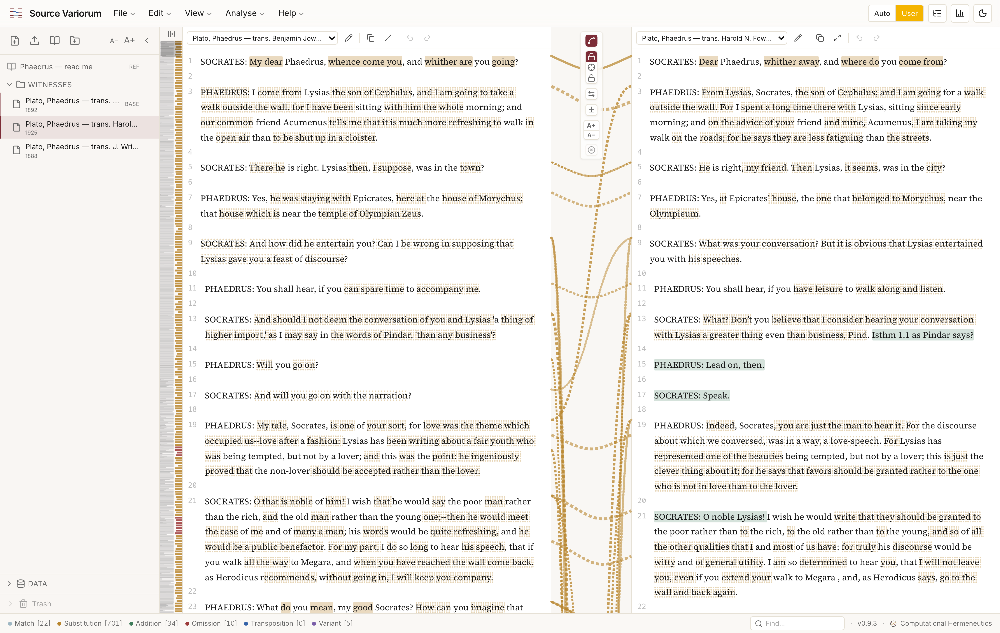
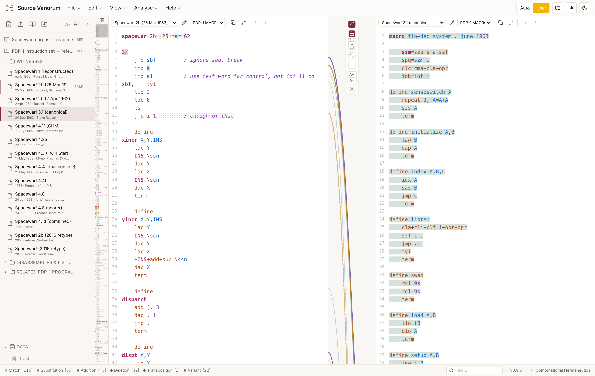
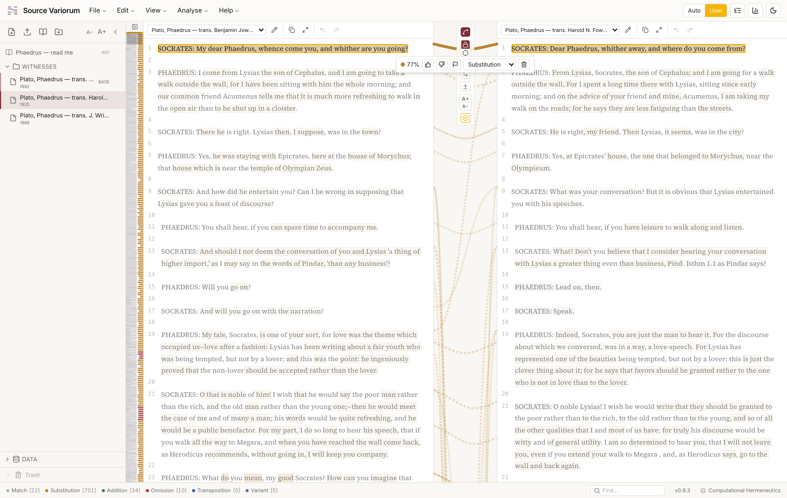
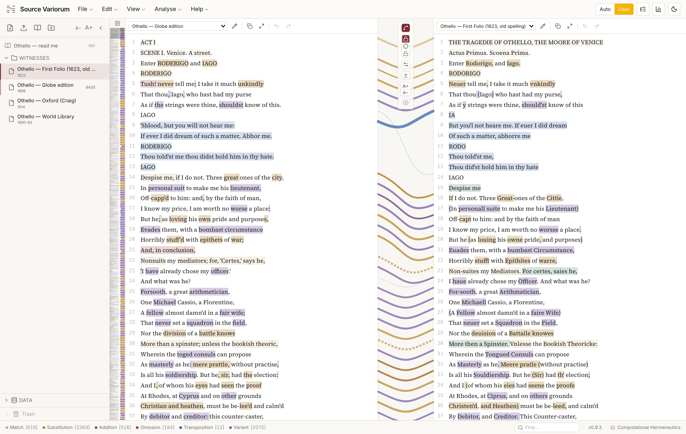
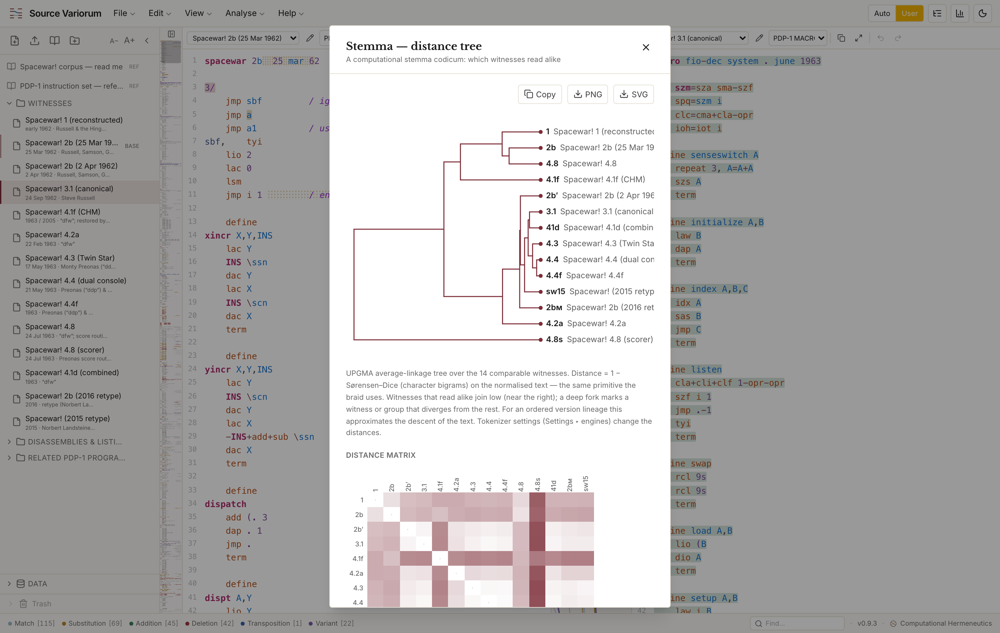
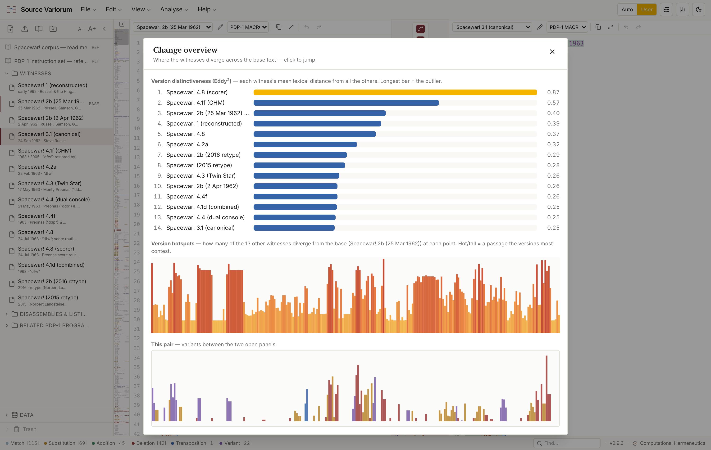
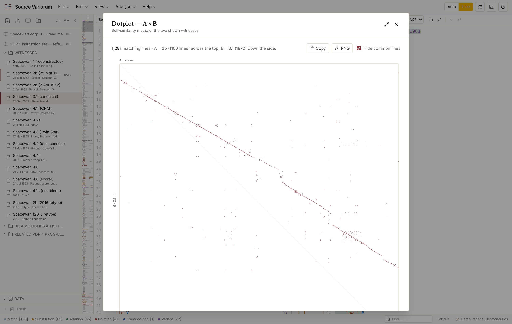

# Source Variorum

> An instrument in the **Computational Hermeneutics** family.

| | |
|---|---|
| **Author** | David M. Berry ([@dmberry](https://github.com/dmberry), University of Sussex, [ORCID 0000-0002-7737-5586](https://orcid.org/0000-0002-7737-5586)) |
| **Version** | 0.9.6 |
| **Date** | June 2026 |
| **Licence** | GPL-3.0-or-later |
| **Summary** | A side-by-side textual collation workbench: collate two or more witnesses of a text — code or prose — and read additions, omissions, substitutions, and transpositions in a braided variorum view, with auto-collation plus hand-correction. |

**Source Variorum** is a side-by-side textual collation workbench. A *variorum*
(from *cum notis variorum*, "with the notes of various people") collates all
known variants of a text so that a reader can track how textual decisions were
made in preparing a text for publication. Source Variorum brings that apparatus
of textual criticism to computational close reading, across two registers:
**source code** and **prose**.

Give it two (and, in a later phase, more) witnesses of a text and it renders them
in parallel with a central *braid*: curved ribbons connecting matching passages
across the two columns, including passages that have **moved** relative to one
another. The crossing of those ribbons is the analytical payload. It shows, at a
glance, where text has been added, deleted, substituted, or transposed.



> The braid in Text mode: Jowett (1892) and Fowler (1925) translations of Plato's *Phaedrus* side by side. Changed words are tinted in each column; ribbons in the central gutter connect the matching passages. The vertical strip on the left is a whole-document minimap of the variation.
>
> *Source Variorum v0.9.3*

## Two engines: CX (code) and TX (text)

The mode selects which **collation engine** runs. They are not just two
typographies over one diff: each segments and matches the witnesses differently,
and carries its own braid options (Analyse ▸ Engines, or Settings).

- **CX-Engine — code.** Aligns **line by line**, monospace, and reads
  **literally**: source is near one-to-one, so it trusts exact line
  correspondence, only pairs genuinely-alike leftover lines (a renamed label, a
  changed operand), and marks a clean addition/deletion otherwise; a block is
  *moved* only when near-identical. Options: **ignore comments** (strip `;` `//`
  `#` `/* … */` so re-/de-commented code still aligns), **detect moved blocks**.
  **Syntax highlighting** for common modern languages (JavaScript/TS, Python,
  HTML, CSS, C/C++, Java, Rust, Go, PHP, SQL, JSON, XML/TEI, Markdown) and
  historical assembly dialects (PDP-1 MACRO, AGC, MAD, FORTRAN, IPL-V, BASIC),
  chosen **per panel** and coloured over the variant tints.
- **TX-Engine — text.** Aligns **sentence by sentence**, proportional type,
  witness sigla, and reads **smartly**: prose is rephrased, so it pairs loosely
  (a reworded sentence stays one substitution locus, not delete-plus-add) and
  accepts fuzzier moves — correspondence is semantic, not positional. Options:
  **regularise spelling** (fold early-modern ↔ modern orthography — long-s, u/v,
  i/j, vv→w, doubled letters, final -e — so old-spelling and modern witnesses
  align), **ignore accidentals** (punctuation), **detect moved passages**.

Both share one similarity primitive (Sørensen–Dice over character bigrams) and
the Juxta-style normalisation toggles; they differ in their unit of alignment,
matching thresholds, and per-engine options. The active engine lives in the
**View** menu and **Settings**; **Analyse ▸ Engines (CX · TX)** explains and
configures each.

## What it shows

- A three-column **braid** (Witness A · ribbon gutter · Witness B) with Bezier
  ribbons whose thickness scales with the length of the matched block.
- Variant typing: **match**, **substitution**, **addition**, **deletion**,
  **transposition** (moved text), and near-identical **variant** (fuzzy match).
  The variant legend + live counts sit in the **status bar** (click a type to
  show/hide it).
- **Word-level refinement** inside a differing sentence or line: only the words
  that actually change are tinted (a CollateX-style token alignment), so the eye
  lands on the divergence rather than the whole locus. Selecting a locus keeps
  its variant-type colour and is framed in a strong **version-variation yellow**
  (a VVV-style highlight); the connecting ribbon stays at the sentence/line level.
- A vertical **overview strip** (a VVV-style minimap) down the left edge: every
  variant as a band at its position in the base text, a viewport box that tracks
  scroll, and click-to-jump. Draggable to widen, hideable. A horizontal
  **change-overview** histogram is also available as a modal (View menu).
- **Confidence** on every braid (its pairing similarity): ribbons draw **solid /
  dashed / dotted** by confidence band (cut-offs user-set in Settings ▸ Braid),
  and the panel highlight echoes it as a **half-tone dot screen** for fuzzier
  loci. Hover a ribbon for its exact %.
- **The click model on a highlight:** a **single click** selects the locus, shows
  its braid, and **pulls the other panel in line** (the linked passage scrolls
  into alignment); a **second click** deselects; a **double-click** selects the
  word (or code token) natively; a **right-click** (or **Alt/Option-click**, a
  backup since macOS can intercept the context menu) looks the word up in the
  **dictionary** (see below).
- A **braid editor** for curating the collation: select a braid
  for a compact editor (it sits in the margin by the braid, hides while scrolling,
  is draggable aside) to **approve 👍** (full confidence; the locus becomes an
  **underline**, the settled state), **doubt 👎** (graduated, −25% per click), flag
  **tentative** (provisional, rendered grey), **swap the type**, or **delete** the
  link. Every edit is undoable and saved with the project as an editorial layer
  over the live auto braid.
- A **dictionary** on right-click / Alt-click. In **CodeX** the token is looked
  up in a bundled **PDP-1 MACRO instruction set** (`public/dictionaries/`, the
  folder where further language references can be dropped) — each entry gives the
  full name, the operand signature, the octal opcode, a description, and a small
  example, with a **reference link** back to the source (Landsteiner's "Inside
  Spacewar!" at masswerk.at). If the token is instead a **macro, label, or
  symbol defined in the witness itself**, the popup also shows the **source
  snippet that defines it** — the function it actually calls, not just a gloss.
  In **TextX** the word is fetched from the free
  [Dictionary API](https://dictionaryapi.dev) (a sandboxed browser cannot reach
  the OS dictionary, so SV queries this instead, degrading gracefully offline).
  The same PDP-1 reference is also a reading document in the Spacewar! corpus
  (*PDP-1 instruction set — reference*). When the popup shows a witness
  definition, **click the header to jump** the panel to where it is defined.
- A **Data** folder at the foot of the sidebar makes the project's non-witness
  data visible: the **editorial layer** (your braid overrides + manual links),
  the **annotations**, and the **dictionary** — each opens in a read-only viewer.
  Everything here is saved with the project.
- An auto-generated **critical apparatus** listing every locus of divergence by
  siglum, and a **deep-dive** modal of quantitative statistics (verbatim overlap,
  moved-block counts, Jaccard / Dice / cosine similarity).
- A **stemma (distance tree)** (Analyse menu): a computational *stemma codicum*
  over all comparable witnesses — a UPGMA dendrogram clustering them by pairwise
  dissimilarity (1 − Sørensen–Dice), with a distance-matrix heatmap. For an
  ordered version lineage it approximates the descent of the text.
- A **dotplot (A × B)** (Analyse menu): a self-similarity matrix of the two shown
  witnesses — a point wherever a line (code) or sentence (prose) matches. The
  diagonal is shared text in order; off-diagonal streaks are moved blocks or
  repeats; gaps are additions/deletions. Common units can be filtered out.
- A **find** box in the status bar marks matches across both panels with
  next/previous navigation.
- Line numbers in both panels, kept visible while editing.

## Screenshots

### Code mode, with syntax highlighting



> The CX-Engine on two versions of the *Spacewar!* PDP-1 source (1962). Line-by-line alignment, PDP-1 MACRO syntax highlighting (green comments, orange `define` directives, coloured instructions) layered over the variant tints, with the braid showing where code was added, changed, or moved.
>
> *Source Variorum v0.9.3*

### Editing the braid (User mode)



> Selecting a locus lights its ribbon and isolates it from the rest. The floating action bar shows the similarity score and lets you approve, doubt, flag, retype, or delete the pairing. Edits persist as a separate editorial layer, so **User** mode is your close read and **Auto** stays the pristine engine reading.
>
> *Source Variorum v0.9.3*

### A multi-witness project



> A project holds any number of witnesses (here four *Othello* editions, 1623–1993) in a foldered sidebar; you pick any two to braid. The Globe (1866) against the First Folio (1623, old spelling) shows the spelling-regularisation and move detection at work: dense ribbons, with a transposed passage crossing the gutter.
>
> *Source Variorum v0.9.3*

### Analysis views



> **Stemma (distance tree).** A UPGMA dendrogram and distance-matrix heatmap over the whole corpus, clustering the witnesses that read alike, a computational *stemma codicum*.
>
> *Source Variorum v0.9.3*



> **Change overview.** Across all witnesses: the *Eddy²* ranking of each version's distance from the rest (the outlier at the top), and the *Viv* hotspot histogram marking the passages the versions most contest.
>
> *Source Variorum v0.9.3*



> **Dotplot (A × B).** A self-similarity matrix of two witnesses. The diagonal is shared order; off-diagonal marks and gaps are moved, repeated, added, or deleted lines.
>
> *Source Variorum v0.9.3*

## The project workbench

A project holds many sources, organised in a small file organiser:

- A **Sources** sidebar with a toolbar: add a source, import several files at
  once, load a **sample** collation, create folders. Sources can be filed into
  **collapsible folders** (inline-renamed), moved, and sent to a **trash** (with
  restore / empty). The sidebar is **resizable and hideable** (drag its edge, or
  toggle it from the View menu).
- Each panel has its own **toolbar** (CCS-WB style) so the two witnesses can be
  worked on individually: **edit · annotate · language · copy · expand ·
  undo/redo**. Edit and the syntax language are per-panel.
- **Click a source** to open it in the right (comparison) panel against the
  left, which acts as the **base** / copy-text; the per-panel dropdowns place
  either side explicitly.
- **Edit** witness text in place to correct or normalise it, with **undo/redo**.
  Every source keeps its pristine **original**, so an edited source is flagged
  and can be **reverted to original** (or **duplicated** as a working copy);
  the whole project can also be reverted to the last saved state.
- **⌘/Ctrl-click** any passage to attach a marginal annotation; an **annotate**
  mode (per panel) turns a plain click into a note.
- **Settings** (Help menu) — **User**, **Appearance** (mode, theme, text size),
  **Braid** (confidence band cut-offs, hide-below-confidence, opacity,
  long-distance hiding, cable sag), **CodeX** / **TextX** (per-engine matching
  options), and **Data** (editorial-layer counts + a Danger zone: *re-run auto
  collation* and *clear all braids*).
- **Auto | User** (top-right toggle): **User** (default) applies your editorial
  layer (overrides + hand links) — a working close read; **Auto** previews the
  pristine engine braid without deleting your edits. Editing a braid flips you to
  User automatically. *Clear all braids* in Settings ▸ Data returns the pristine
  auto-collation for good. If braids ever look missing, **View ▸ Show my braids**
  (or Settings ▸ Braid) resets the braid view to defaults.
- An on-screen **assistant** (a paperclip with opinions) offers witty, mode-aware
  tips and the occasional quotation — different banter for CodeX and TextX. It
  never blocks the page (the find box, the status bar, controls behind it stay
  clickable).
  Dismiss with the ✕ and he returns at a random moment; type **"clippy"** to
  summon him, or **"hacker"** for **Hackerman**, a green-terminal h4x0r alarmed by
  what he found inside the collation engine. Off switch in Settings ▸ Appearance.
- **Storage / "user mode":** the collation is never stored as a frozen braid.
  Source witnesses plus an **editorial layer** (braid overrides + hand links,
  keyed by the reading pair) live on the project; on load the auto braid is
  re-derived and your edits are **re-applied on top** — so a project with edits
  reopens in your edited state. The layer is plain, human-readable JSON in the
  `.svar` (`variantOverrides` / `manualLinks` / `annotations`).
- **New / Open / Save** projects as `.svar` files; **export** to Markdown, **TEI
  P5** (parallel-segmentation `<app>/<rdg>`), PDF, or JSON. The working project
  autosaves to the browser.

## How the collation is computed

The app computes the collation **live in the browser**, every time the view
renders. The engine in `src/lib/collate/` is a set of pure, deterministic
functions: it segments each witness, aligns them, types each variant, and detects
moved blocks. A saved `.svar` project stores **only the source of truth** —
witnesses, mode, your apparatus notes and annotations — and **never the variants**,
which are recomputed deterministically on load. Nothing about the collation is
precomputed or baked into the data.

## Provenance

Source Variorum reuses the close-reading scaffolding of
[LLMbench](https://github.com/vector-lab-tools/LLMbench) (annotation system, word
diff, similarity metrics, editorial interface) but is a distinct instrument in a
distinct family. It is local-first: everything runs in the browser, with no model
calls and no server. The collation engine (`src/lib/collate/`) is a set of pure,
deterministic functions; the interface consumes their output and never recomputes
alignment.

It was begun as part of a Critical Code Studies study of the 1962 PDP-1
*Spacewar!* for a book, and is built to be general: the same collational apparatus
reads code and prose.

## Design lineage

Juxta / Juxta Commons, the Versioning Machine, and dotplot / sequence-alignment
views, reworked as a braided variorum for both code and text.

It is also inspired, in part, by the **Version Variation Visualization (VVV) /
Translation Arrays** project at Swansea University (Tom Cheesman, Robert S.
Laramee, Kevin Flanagan, Stephan Thiel and colleagues) — its base-text +
aligned-versions interface, its use of a strong highlight colour for version
variation, and its *Eddy* / *Viv* metrics for where versions most diverge. See
ShakerVis (Geng, Cheesman, Laramee, Flanagan & Thiel, *Information Visualization*
14(4), 2013), <https://cronfa.swan.ac.uk/Record/cronfa24678>, and Geng, Laramee,
Cheesman, Ehrmann & Berry, "Visualising Translation Variation: Shakespeare's
*Othello*" (ISVC 2011).

## Development

```bash
npm install
npm run dev      # http://localhost:3000
npm run build
npm run lint
```

Stack: Next.js 16, React, TypeScript, Tailwind, CodeMirror, jsdiff, jsPDF.

## Licence

GNU General Public License v3.0 or later (GPL-3.0-or-later) © 2026 David M. Berry. See [LICENSE](LICENSE).

Source Variorum was previously released under the MIT License. As sole copyright holder, David M. Berry has relicensed the project, including all prior versions, under the GPL-3.0-or-later.

## Citation

[](https://doi.org/10.5281/zenodo.23763287)

If you use Source Variorum in your research, please cite it via its Zenodo archive. The concept DOI [10.5281/zenodo.23763287](https://doi.org/10.5281/zenodo.23763287) always resolves to the latest version; version 0.9.6 is archived at [10.5281/zenodo.23763288](https://doi.org/10.5281/zenodo.23763288). Full citation metadata is in [CITATION.cff](CITATION.cff).
